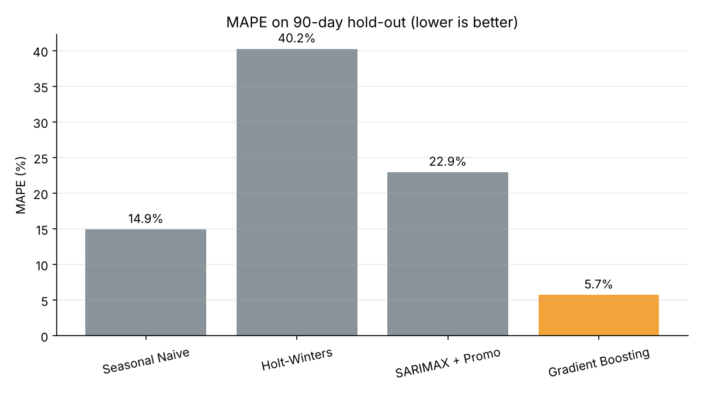
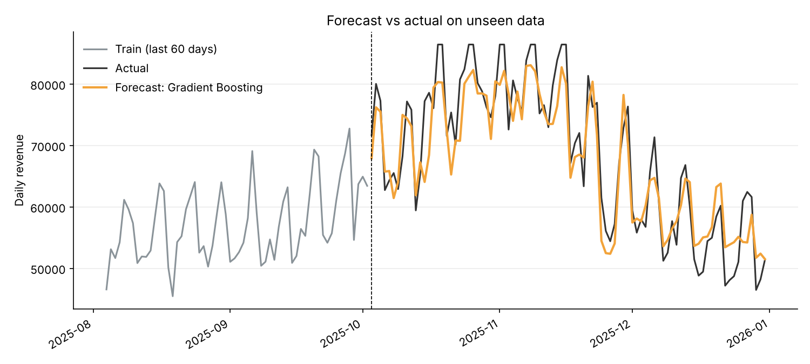
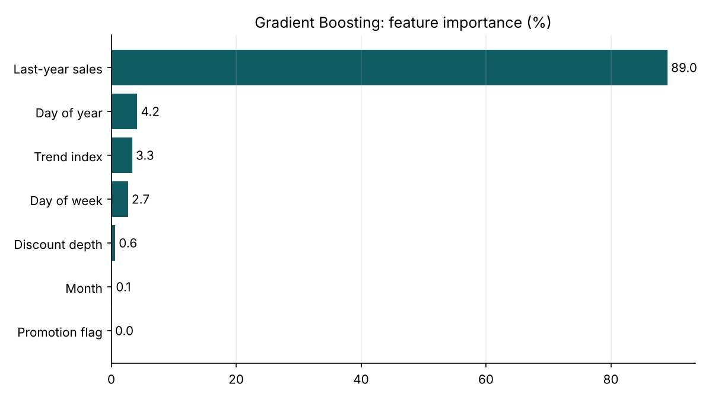

# E-commerce Sales Forecasting

**Project 50 | Time-Series Forecasting**

Forecasts future e-commerce sales from historical sales, product category, seasonality, promotions and customer demand. This is the working code behind the project presentation.

**Author:** Yash Pandey, BTech CSE (Data Science & AI), Integral University, Lucknow
**Contact:** ypandey@student.iul.ac.in | Enrollment No. 2500101226

## Pipeline

Collect -> Clean -> Explore -> Engineer features -> Model -> Evaluate

1. **Collect**: `data/sales.csv` (daily sales by category; synthetic demo data generated by `src/generate_data.py`)
2. **Clean**: sort by time, aggregate categories to one daily series, fill missing dates, cap outliers
3. **Explore**: monthly trend and seasonality chart
4. **Engineer features**: day of week, day of year, month, trend index, promotion flag, discount depth, last-year sales (364-day lag)
5. **Model**: four models of increasing sophistication
6. **Evaluate**: MAE, RMSE and MAPE on a time-based hold-out (last 90 days, never shuffled)

## Models

| Model | Type | Notes |
|---|---|---|
| Seasonal Naive | Baseline | Repeats the last observed week |
| Holt-Winters | Exponential smoothing | Level, trend and weekly seasonality |
| SARIMAX + Promo | Statistical | Weekly seasonality, promotion flag as exogenous input |
| Gradient Boosting | Machine learning | Calendar, promotion and last-year sales features |

## Dataset schema

| Field | Type | Description |
|---|---|---|
| date | date | Daily timestamp |
| category | text | Product category |
| units_sold | int | Units sold that day |
| price | float | Average selling price |
| promo_flag | 0 / 1 | Promotion active |
| discount_pct | float | Discount depth |
| traffic | int | Site visits (demand proxy) |
| revenue | float | Target to forecast |

## Results (demo run, synthetic data, 90-day hold-out)

| Model | MAE | RMSE | MAPE (%) |
|---|---|---|---|
| Seasonal Naive | 10169 | 11630 | 14.9 |
| Holt-Winters | 23360 | 31629 | 40.2 |
| SARIMAX + Promo | 13650 | 17303 | 22.9 |
| Gradient Boosting | 3848 | 4578 | 5.7 |

Train: 1,006 days (Jan 2023 - Oct 2025). Test: last 90 days (Oct - Dec 2025), the festive peak.





> These results come from synthetic data and will change if you use a real dataset.

## How to run

```bash
pip install -r requirements.txt
python src/generate_data.py      # optional: regenerate the demo dataset
python src/forecast.py           # train, evaluate, save charts to outputs/
```

To use your own data, keep the same column names and run:

```bash
python src/forecast.py --data path/to/your_sales.csv
```

## Project structure

```
ecommerce-sales-forecasting/
├── data/sales.csv
├── outputs/            charts, metrics.csv, forecasts.csv
├── src/
│   ├── generate_data.py
│   └── forecast.py
├── requirements.txt
└── README.md
```

## Future scope

Prophet, LSTM and hybrid models; forecasts per category and product; external data (holidays, weather, competitor prices); automated retraining with a live dashboard.
