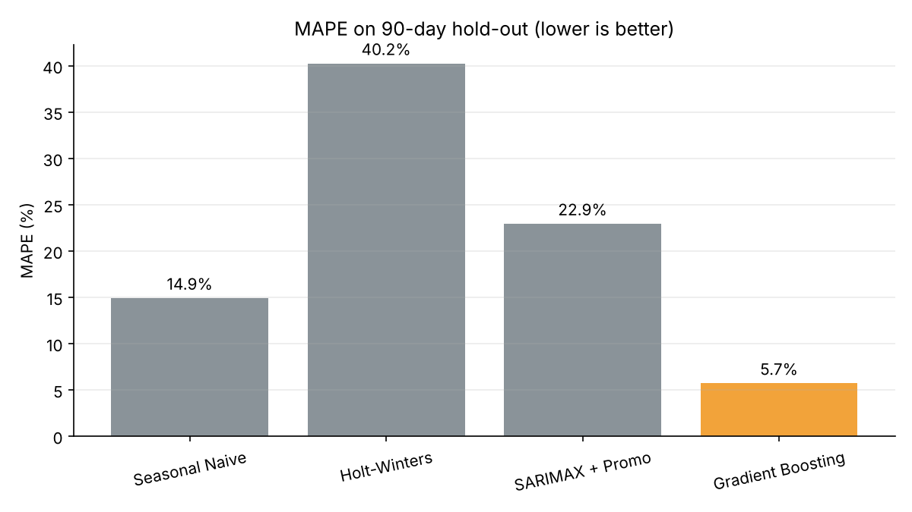
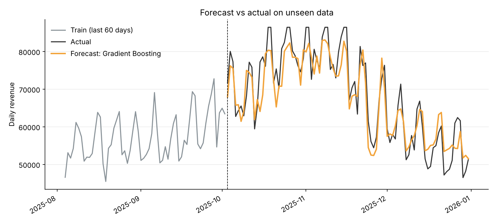
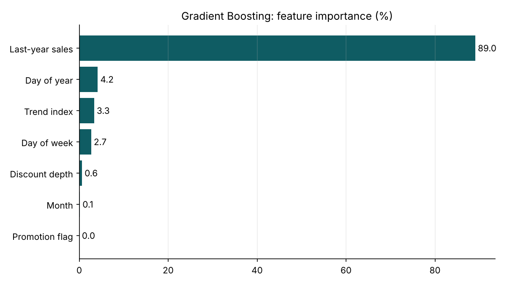

# E-commerce Sales Forecasting

**Project 50 | Time-Series Forecasting**

Forecasts future e-commerce sales from historical sales, product category, seasonality, promotions and customer demand. This repository is the working code behind the project presentation (`Ecommerce_Sales_Forecasting-1.pptx`).

**Author:** Yash Pandey, B.Tech CSE (Data Science & AI), Integral University, Lucknow
**Contact:** ypandey@student.iul.ac.in

---

## Table of Contents

- [Project Overview](#project-overview)
- [Objectives](#objectives)
- [Dataset](#dataset)
- [Technologies Used](#technologies-used)
- [Repository Structure](#repository-structure)
- [Methodology](#methodology)
- [Models](#models)
- [Results](#results)
- [Key Findings](#key-findings)
- [Limitations](#limitations)
- [Installation](#installation)
- [Running the Project](#running-the-project)
- [Future Scope](#future-scope)

---

## Project Overview

Online retailers need to know how much they will sell in the coming weeks so they can plan stock, staffing and marketing. Sales are not random: they follow weekly patterns, yearly seasons, festive peaks and the effect of promotions.

This project builds a daily revenue forecasting pipeline and compares four models of increasing sophistication, from a simple baseline to a machine-learning model. Every model is judged on the same unseen 90-day period, so the comparison is fair.

## Objectives

1. Load and clean daily e-commerce sales data.
2. Explore the trend and the yearly and weekly seasonality in sales.
3. Engineer features that capture calendar effects, promotions and last year's sales.
4. Train and compare four forecasting models of increasing sophistication.
5. Evaluate every model on a time-based hold-out using MAE, RMSE and MAPE.
6. Identify which features the best model relies on.
7. Provide code that anyone can re-run, including on their own sales data.

## Dataset

The data in `data/sales.csv` is **synthetic demo data** created by `src/generate_data.py`. It was built to behave like real retail sales: a growth trend, weekly and yearly seasonality, a festive-season peak, and promotion effects.

It covers daily sales by product category from **January 2023 to December 2025**.

| Field | Type | Description |
|---|---|---|
| `date` | date | Daily timestamp |
| `category` | text | Product category |
| `units_sold` | int | Units sold that day |
| `price` | float | Average selling price |
| `promo_flag` | 0 / 1 | Promotion active |
| `discount_pct` | float | Discount depth |
| `traffic` | int | Site visits (demand proxy) |
| `revenue` | float | **Target to forecast** |

> **Note:** Because the data is synthetic, the results below show that the pipeline works. They are not a claim about how these models would perform on a real store. See [Limitations](#limitations).

## Technologies Used

| Technology | Purpose |
|---|---|
| Python | Main programming language |
| Pandas, NumPy | Data loading, cleaning and feature engineering |
| Statsmodels | Holt-Winters and SARIMAX models |
| Scikit-learn | Gradient Boosting model and evaluation metrics |
| Matplotlib | Charts |

## Repository Structure

```text
E-commerce-sales-forecasting-/
├── data/
│   └── sales.csv                    # daily sales by category (synthetic)
├── outputs/
│   ├── 02_model_comparison.png      # MAPE of all four models
│   ├── 03_forecast_vs_actual.png    # forecast against real values
│   ├── 04_feature_importance.png    # what drives the best model
│   ├── metrics.csv                  # MAE, RMSE, MAPE per model
│   └── forecasts.csv                # forecasts for the 90-day hold-out
├── src/
│   ├── generate_data.py             # creates the demo dataset
│   └── forecast.py                  # trains, evaluates, saves charts
├── Ecommerce_Sales_Forecasting-1.pptx   # project presentation
├── requirements.txt
└── README.md
```

## Methodology

**Collect -> Clean -> Explore -> Engineer features -> Model -> Evaluate**

1. **Collect:** read `data/sales.csv` (daily sales by category).
2. **Clean:** sort by time, aggregate categories into one daily series, fill missing dates and cap outliers.
3. **Explore:** monthly trend and seasonality chart.
4. **Engineer features:** day of week, day of year, month, trend index, promotion flag, discount depth and last-year sales (364-day lag).
5. **Model:** train four models of increasing sophistication.
6. **Evaluate:** MAE, RMSE and MAPE on a time-based hold-out (the last 90 days, never shuffled).

**Why a time-based split?** Sales data is ordered in time. Shuffling it would let the model see the future while training, which gives falsely good scores. The model is trained only on the past and tested on the 90 days that follow.

- **Train:** 1,006 days (Jan 2023 to Oct 2025)
- **Test:** the last 90 days (Oct to Dec 2025), which is the festive peak and the hardest period to forecast

The 364-day lag is used instead of 365 so that a day always lines up with the same day of the week a year earlier.

## Models

| Model | Type | Notes |
|---|---|---|
| Seasonal Naive | Baseline | Repeats the last observed week |
| Holt-Winters | Exponential smoothing | Level, trend and weekly seasonality |
| SARIMAX + Promo | Statistical | Weekly seasonality, promotion flag as exogenous input |
| Gradient Boosting | Machine learning | Calendar, promotion and last-year sales features |

The simple baseline matters. A complex model is only worth using if it beats "repeat last week".

**Metrics used**

- **MAE** (Mean Absolute Error): the average miss, in revenue units.
- **RMSE** (Root Mean Squared Error): like MAE but punishes large misses more.
- **MAPE** (Mean Absolute Percentage Error): the average miss as a percentage of actual sales. Lower is better.

## Results

Demo run on synthetic data, 90-day hold-out:

| Model | MAE | RMSE | MAPE (%) |
|---|---:|---:|---:|
| Seasonal Naive | 10,169 | 11,630 | 14.9 |
| Holt-Winters | 23,360 | 31,629 | 40.2 |
| SARIMAX + Promo | 13,650 | 17,303 | 22.9 |
| **Gradient Boosting** | **3,848** | **4,578** | **5.7** |

**Best model: Gradient Boosting, with about 62% lower MAPE than the Seasonal Naive baseline.**

### MAPE by model



### Forecast vs actual on unseen data



### Feature importance (Gradient Boosting)



## Key Findings

- **Gradient Boosting wins clearly** (5.7% MAPE) because it can use last year's sales and calendar information together.
- **Last-year sales is by far the most important feature** (89.0% of the importance), followed by day of year (4.2%), trend index (3.3%) and day of week (2.7%). The model mostly learns "this time last year, adjusted for the trend".
- **Holt-Winters did worst** (40.2% MAPE). It only models weekly seasonality, so it cannot anticipate the festive peak in the test period. This is the likely reason, and it shows why yearly seasonality matters here.
- **SARIMAX with the promotion flag** improved on Holt-Winters but still did not beat the simple Seasonal Naive baseline on this test period.

## Limitations

Being clear about what this project does not show:

- **Synthetic data.** The scores come from data generated by `src/generate_data.py`, so they show that the pipeline works, not how it would perform on a real store. Real sales are noisier and include stock-outs, returns, price changes and one-off events.
- **Single hold-out.** All models are judged on one 90-day window, which is also the festive peak. A different window could change the ranking. Rolling-origin (walk-forward) cross-validation would be a more robust test.
- **Heavy reliance on last year's sales.** Gradient Boosting gets 89% of its signal from the 364-day lag. It needs at least a year of history and will struggle with new products or an unusual year.
- **Promotion flag shows almost no importance (0.0%).** This is likely because the promotion effect is already carried by the last-year sales and calendar features in this dataset. It should be re-tested on real data before concluding that promotions do not matter.
- **One combined series.** All categories are aggregated into one daily revenue series, so per-category and per-product forecasts are not produced.
- **No external factors.** Holidays, weather and competitor prices are not used.

## Installation

**Requirements:** Python 3.9 or newer and Git.

**1. Clone the repository**

```bash
git clone https://github.com/yashpandey3133-oss/E-commerce-sales-forecasting-.git
cd E-commerce-sales-forecasting-
```

**2. Create a virtual environment (recommended)**

```bash
python -m venv venv
```

Activate it on Windows:

```bash
venv\Scripts\activate
```

On macOS or Linux:

```bash
source venv/bin/activate
```

**3. Install dependencies**

```bash
pip install -r requirements.txt
```

## Running the Project

Run these from the project root folder:

```bash
python src/generate_data.py      # optional: regenerate the demo dataset into data/sales.csv
python src/forecast.py           # train, evaluate and save charts and metrics to outputs/
```

The script prints the results table and saves the charts, `metrics.csv` and `forecasts.csv` in `outputs/`.

**Sample output**

```text
Train: 1006 days (2023-01-01 to 2025-10-02)
Test : 90 days (2025-10-03 to 2025-12-31)

                        MAE      RMSE  MAPE (%)
Seasonal Naive     10168.93  11629.91     14.90
Holt-Winters       23360.04  31628.61     40.24
SARIMAX + Promo    13650.50  17303.01     22.93
Gradient Boosting   3847.65   4578.18      5.70

Best model: Gradient Boosting (MAPE 5.7%, 62% lower MAPE than Seasonal Naive)
```

### Using your own data

Keep the same column names as the [dataset schema](#dataset) and run:

```bash
python src/forecast.py --data path/to/your_sales.csv
```

## Future Scope

- Replace the synthetic data with a real public retail dataset and compare results.
- Add Prophet, LSTM and hybrid models.
- Forecast per category and per product instead of one combined series.
- Add external data: holidays, weather and competitor prices.
- Use rolling-origin cross-validation for a more robust evaluation.
- Add automated retraining with a live dashboard.

